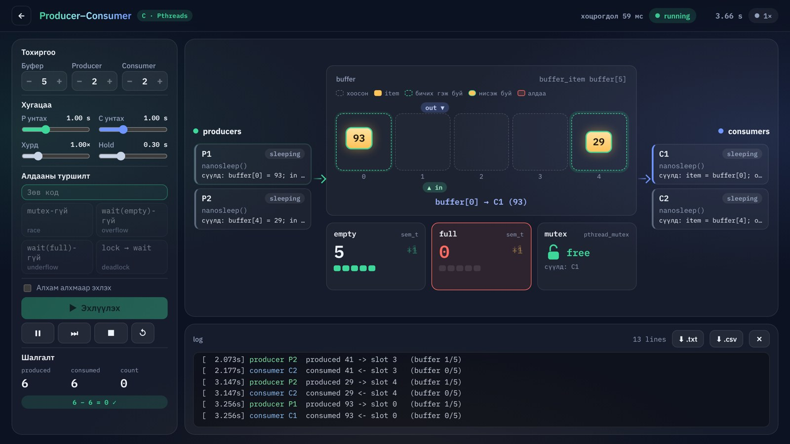
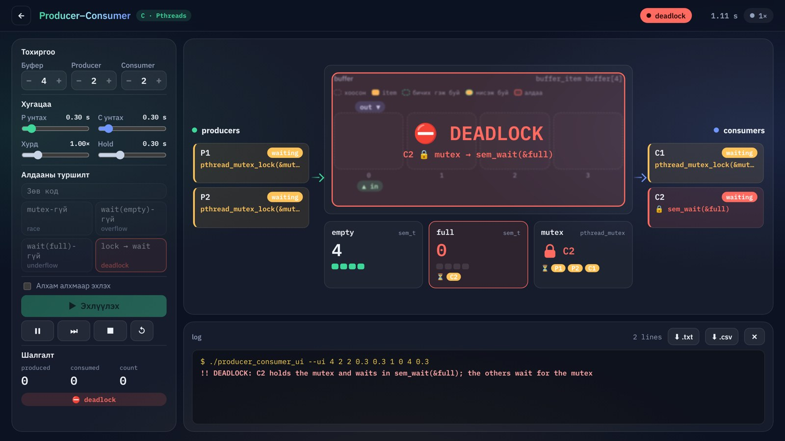
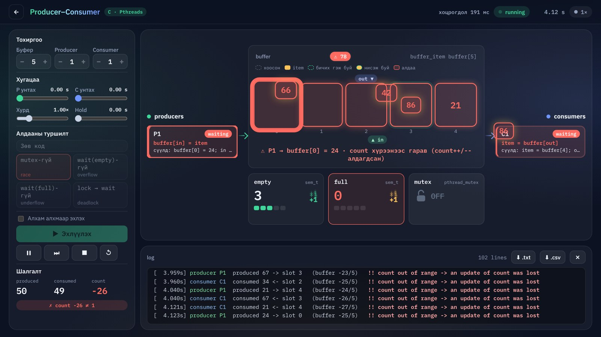

# V-1-12 – Producer–Consumer Problem (Buffer Animation)

**Сургууль:** Шинжлэх Ухаан Технологийн Их Сургууль, Мэдээлэл, Холбооны Технологийн Сургууль

**Хичээл:** F.CSM302 Үйлдлийн систем · Бие даалт 2 (Final)

**Багийн код (хуваарилалтын код):** V-1-12

**Шалгасан багш:** Г. Ганбат /F.CS10/

**Сурах бичгийн бүлэг:** 7-р бүлэг – Synchronization Examples (Silberschatz, Galvin, Gagne – Operating System Concepts, 10th ed.)

**Төслийн нэр:** Programming Project 4 – The Producer–Consumer Problem (Buffer animation UI)

## Багийн гишүүд

| Оюутны код | Нэр |
|------------|-----|
| B241910012 | Н. Баасандорж |
| B241910035 | Э. Анунбаяр |
| B222230020 | Э. Ганболд |
| B242270014 | У. Ариунболд |
| B232270028 | Г. Оюунбатбаатар |

## Зорилго

Bounded buffer (цагираг дараалал)-ийг `empty` / `full` тоолох семафор болон `pthread_mutex_t`-ээр хамгаалж, C / POSIX Pthreads дээр хэрэгжүүлэх. Producer, consumer бүр тусдаа OS thread бөгөөд тэдний буфер руу бичих, буферээс уншихыг browser-based интерактив UI дээр алхам алхмаар buffer animation-оор харуулна. Синхрончлолын 4 сонгодог алдаа (race condition, overflow, underflow, deadlock)-г санаатай гаргаж, программ өөрөө илрүүлдгийг харуулна.

### Алгоритм

| Алхам | Producer | Consumer |
|:-:|---|---|
| 1 | `wait(empty)` – сул нүд хүлээх | `wait(full)` – дүүрэн нүд хүлээх |
| 2 | `lock(mutex)` – critical section-д орох | `lock(mutex)` – critical section-д орох |
| 3 | `buffer[in] = item` | `item = buffer[out]` |
| 4 | `unlock(mutex)` | `unlock(mutex)` |
| 5 | `signal(full)` – full + 1 | `signal(empty)` – empty + 1 |

Семафор 0 бол thread блоклогдоно. Mutex нэг удаад зөвхөн нэг thread-ийг critical section-д оруулна.

## Дэлгэцийн зураг

Бүх зургийг программыг бодитоор ажиллуулж авсан.

| Нүүр хуудас | Хэвийн ажиллагаа |
|---|---|
|  |  |
| Python жишээ эсвэл C · Pthreads горимыг сонгоно. | item-үүд producer-оос буфер рүү, буферээс consumer руу шилжиж байна. Шалгалт ногоон. |

| Deadlock (`--bug order`) | Race condition (`--bug no-mutex`) |
|---|---|
|  |  |
| lock → wait дараалал буруу: C1 mutex барьсаар хүлээж, бүгд гацсан. | Mutex-гүй 1P/1C: буферт 1 item байхад count −26 болж эвдэрсэн, программ илрүүлэв. |

## Quick Start

**Шаардлага:** Linux (Debian / Ubuntu) эсвэл Windows 10/11 дээрх WSL, `gcc`, `make`, Python 3 (гадаад сан шаардлагагүй), хөтөч (Chrome, Edge, Firefox).

```
# 0. Шаардлагатай багц
sudo apt install git build-essential python3

# 1. Татах
git clone https://github.com/anunbayar1/CSM302-2627-BD1.git
cd CSM302-2627-BD1

# 2. Ажиллуулах (C программыг автоматаар compile хийж, хөтөч нээгдэнэ)
make -C src/c
python3 src/gui.py
# → http://127.0.0.1:8765/   (унтраахдаа терминалд Ctrl+C)

# 3. Тушаалын мөрөөс (номын дагуу)
make -C src/c BUFFER_SIZE=10         # өөр хэмжээ (1–20): өөрчлөгдвөл өөрөө дахин хөрвүүлнэ
./src/c/producer_consumer 5 3 3      # <унтах сек> <producers> <consumers>
./src/c/producer_consumer --bug no-mutex 5 3 3   # туршилт: no-mutex | no-empty | no-full | order

# Хурдан жишээ (-q: товч гаралт)
./src/c/producer_consumer -q 2 3 3 0.05
# produced=217 consumed=216 in_buffer=1 count=1 -> CONSISTENT
./src/c/producer_consumer -q --bug order 2 2 2 0.05
# DEADLOCK: no progress for the last 2.09s

# 4. Автомат тест (GUI шаардахгүй)
python3 -m unittest discover -s tests   # Ran 48 tests … OK (skipped=2)
make -C src/c test                      # ALL TESTS PASSED
make -C src/c tsan                      # TSAN: no data race reported
```

> Тоонууд ажиллуулах бүрт өөр гарна. Гол нь `CONSISTENT` эсвэл `DEADLOCK` гэсэн дүгнэлт.

### Windows дээр

**А. WSL2 (бүрэн ажиллагаа, C горим орно):** PowerShell-ийг администратороор нээгээд:

```
wsl --install -d Ubuntu
```

Компьютерээ дахин асаагаад **Ubuntu** терминалыг нээнэ. Тэндээ дээрх Linux-ийн 0–4-р алхмыг яг адилхан хийнэ. `http://127.0.0.1:8765/` хаягийг Windows-ийн хөтөчөөр нээнэ.

**Б. Шууд Windows дээр (зөвхөн Python · жишээтэй горим):**

1. [python.org](https://www.python.org/downloads/)-оос Python 3 суулгана (*Add python.exe to PATH*-ийг чагтална).
2. [Git for Windows](https://git-scm.com/download/win) суулгана, эсвэл GitHub дээрээс **Code → Download ZIP** хийж задлана.
3. PowerShell эсвэл Command Prompt дээр:

```
git clone https://github.com/anunbayar1/CSM302-2627-BD1.git
cd CSM302-2627-BD1
py src\gui.py
```

Энэ горимд C · Pthreads хуудас ажиллахгүй (нүүр хуудас дээр шар анхааруулга гарна), учир нь C программ POSIX семафор (`sem_timedwait`) ашигладаг. C горимыг ажиллуулахын тулд А хувилбарыг ашиглана. Python тестийг `py -m unittest tests.test_buffer` командаар ажиллуулж болно.

### Туршсан орчин

* Debian (gcc, GNU Make, Python 3.13)
* Ubuntu 24.04 (gcc 13.3.0, Make 4.3, Python 3.13)
* Windows 11 WSL (Python 3.14), GitHub-аас шинээр татаж шалгасан
* Хөрвүүлэлт: `gcc -Wall -Wextra -O2 -std=c11 -pthread`, сануулгагүй

## Хавтасны бүтэц

| Зам | Агуулга |
|---|---|
| `src/c/` | C / Pthreads эх код: `buffer.c` (insert_item / remove_item, empty, full, mutex), `main.c` (номын CLI), `ui.c` (UI-д төлөв дамжуулах горим), `Makefile` |
| `src/gui.py` | localhost веб сервер (Python стандарт сан), C программыг (`producer_consumer_ui`, CLI-ийн build-ийг дарж бичихгүй) удирдана |
| `src/bounded_buffer.py` | Python хэрэгжүүлэлт (шуудангийн жишээтэй горимд) |
| `src/ui/` | `home.html` (горим сонгох), `mail.html` (шуудангийн жишээ), `raw.html` (C · Pthreads), `tour.json` (дуут тайлбар) |
| `tests/` | `test_buffer.py`, `test_c.py`, `test_web.py` (нийт 48 автомат тест) |
| `docs/` | Poster, Final Report, Manual, `img/` дэлгэцийн зургууд (доорх «Баримт бичиг» хэсгийг үз) |
| `tools/` | `make_voice.py` – дуут тайлбарын аудио үүсгэгч (edge-tts) |

## Үндсэн боломжууд

* Нүүр хуудаснаас 2 горим сонгоно:
  * **Python · жишээтэй**: шуудан зөөгч, хэрэглэгч, шуудангийн хайрцгийн жишээгээр, монгол дуут тайлбартай.
  * **C · Pthreads**: жишээгүй, C программын бодит ажиллагаа: producers → буфер → consumers.
* BUFFER_SIZE (1–20), producer, consumer-ийн тоо (1–10), хурдыг тохируулна. Хурдыг ажиллаж байх үед ч өөрчилж болно.

  | Тохиргоо | Хүрээ | Анхдагч |
  |---|---|---|
  | Буферийн хэмжээ (`BUFFER_SIZE`) | 1–20 | 5 |
  | Producer, consumer-ийн тоо | 1–10 | 2, 2 |
  | Унтах хугацаа (сек) | 0–3 | 1.0 |
  | Хурд | 0.25–4× | 1× |
  | Hold: төлөвийг харуулах удаашрал (0 = бодит хурд) | 0–1 с | 0.3 |
  | Алдааны горим | 5 сонголт (зөв код + 4 алдаа) | зөв код |

* Start / Pause / Step / Stop / Reset удирдлага. Stop дарахад эцсийн дүн лог дээр гарна.
* `empty`, `full` семафорын утга, `mutex`-ийн эзэмшигч болон хүлээж буй thread-үүд, `in` / `out` заагч.
* `produced − consumed = buffer = count ✓` тууштай байдлын шалгалт (`count` нь C-ийн хувьсагч өөрөө). Ногоон бол бүх тоо таарч байна, улаан бол алдаа гарсан.
* Буферийн дээр тэмдэглэгээний тайлбар (legend), баруун дээд буланд animation-ийн хоцрогдол (мс). 300 мс-ээс их хоцрох нислэгийг алгасаж, нүд үргэлж C-ийн бодит төлвийг харуулна.
* **Алдааны туршилт** (C хуудасны «алдаа» сонголт, CLI `--bug`): зөв кодоос нэг алдаа гаргаж, юу болохыг харуулна. Алдаа бүр улаанаар тэмдэглэгдэж, лог болон эцсийн дүнд гарна.

  | Сонголт | Кодын алдаа | Үр дагавар / хүлээгдэх дүгнэлт |
  |---|---|---|
  | `no-mutex` | `pthread_mutex_lock/unlock` байхгүй | race condition: хоёр thread нэг нүд рүү бичиж item алга болно. 1P/1C үед зөвхөн `count++`/`count--` эвдэрнэ (`count_errors`) → `INCONSISTENT` |
  | `no-empty` | producer `sem_wait(&empty)` хийхгүй | overflow: уншаагүй item дээр дарж бичнэ → `INCONSISTENT` |
  | `no-full` | consumer `sem_wait(&full)` хийхгүй | underflow: хоосон нүднээс уншина → `INCONSISTENT` |
  | `order` | `mutex_lock` → `sem_wait` дараалал буруу | deadlock: mutex барьсан thread 0 утгатай семафор хүлээж, бусад нь mutex хүлээнэ (бүтцээр нь илрүүлнэ, run богино ч гэсэн) → `DEADLOCK` |
* producer / consumer sleep (0–3 сек), хурд (0.25–4×) болон hold (0–1 сек)-ыг гулсуураар 0.05-ын нарийвчлалтай, ажиллаж байх үед тохируулна.
* Лог-ийг `.txt` эсвэл `.csv` хэлбэрээр татаж авах.

## Туршилтын үр дүн

| Metric | Утга |
|---|---|
| Зөв кодын run CONSISTENT (5 тохиргоо × 10 run) | **50 / 50** |
| Алдааны горим илэрсэн (5 горим × 5 run) | **25 / 25** |
| Автомат тест | **48 / 48** PASS |
| ThreadSanitizer race | **0** |
| Хамгийн их ачаалал (40 thread, 1 с) | 288 822 item, алдаагүй |

Дахин гаргах: `make -C src/c test` (хэвийн 5 тохиргоо, алдааны горим бүр, буруу оролт), `make -C src/c tsan`, `python3 -m unittest discover -s tests`.

## БД1 → БД2 (Final): шүүмжээр хийсэн сайжруулалт

Харилцан шүүмжээр 11 асуудал илэрсэн (10 нь зөвшөөрсөн, 1 нь хэсэгчлэн). Гол засварууд:

| Priority | Асуудал | Өмнө → Дараа |
|---|---|---|
| Critical | Mutex-гүй 1P/1C үед `count` эвдэрсэн ч `CONSISTENT` гэж дүгнэдэг байсан | `CONSISTENT` → `INCONSISTENT` (count-ийн хүрээ ба эцсийн тэнцлийг шалгана) |
| Major | 0.25 с-ийн богино run-д deadlock-ийг илрүүлдэггүй | 0/3 → 196/200 `DEADLOCK` (бүтцээр илрүүлнэ) |
| Major | `make BUFFER_SIZE=10` хэмжээг өөрчилдөггүй | 5 хэвээр → 10 (`.buffer_size` stamp) |
| Major | Hold нь «зөвхөн дүрслэл» гэж буруу бичигдсэн | 0–1 с тохируулдаг болж, 0 = бодит хурд |
| Major | UI-ийн хоцрогдол тоолуураас зөрдөг | ~1 с → ≤ 0.3 с |
| Major | Гишүүдийн нэр дутуу, баримт зөрүүтэй | README, Manual, тайланг нэгтгэв |
| Minor | Legend байхгүй, deadlock үед «running» гэж харагддаг | Legend, deadlock төлөв нэмэв |
| Minor | `BUFFER_SIZE=0` шалгалтгүй | хөрвүүлэх үед `#error` |
| Minor | `make tsan` exit кодыг нуудаг | `pipefail`, race гарвал exit 66 |
| Minor | Тестэд `ResourceWarning` 3 | Pipe-ийг хаадаг болсон: 3 → 0 |

Тест 42-оос 48 болсон.

### Зохиомжийн шийдвэр

| Шийдвэр | Шалтгаан |
|---|---|
| `sem_timedwait`, `pthread_mutex_timedlock` (50 мс) | Stop үед блоклогдсон thread ч гарч, программ цэвэр зогсоно. |
| Нүд бүрийн `occ[]` шалгагч | Алдагдсан болон хоосноос уншсан item-ийг тоолно. Алгоритмд нөлөөлөхгүй. |
| Deadlock-ийг бүтцээр илрүүлэх | Хугацааны босго удаан программыг deadlock гэж андуурдаг. |

## Баримт бичиг ба final release

| Файл | Агуулга |
|---|---|
| [docs/V-1-12_Poster.pdf](docs/V-1-12_Poster.pdf) | Постер (үндсэн материал) |
| [docs/V-1-12_Final_Report.pdf](docs/V-1-12_Final_Report.pdf) | Эцсийн тайлан: Reviewer Responses, дахин туршилт ([.docx](docs/V-1-12_Final_Report.docx)) |
| [docs/V-1-12_Manual.pdf](docs/V-1-12_Manual.pdf) | Хэрэглэгчийн гарын авлага ([.docx](docs/V-1-12_Manual.docx)) |

**Final release:** [`v2.0-final`](https://github.com/anunbayar1/CSM302-2627-BD1/releases/latest). Final Report, Manual, Poster нь энэ tag-ийн кодтой нийцнэ. Постерын QR код энэ release руу заана.

## Асуудал гарвал

| Асуудал | Шийдэл |
|---|---|
| `gcc` эсвэл `make` олдсонгүй | `sudo apt install build-essential` |
| C хуудас шар анхааруулгатай | WSL эсвэл Linux дээр ажиллуулна |
| Хөтөч өөрөө нээгдэхгүй | Терминалд хэвлэгдсэн хаягийг гараар нээнэ |
| `DEADLOCK` эсвэл алдаа гараад байна | Алдааны горимд «зөв код» сонгоод Reset дарна |
| Ажиллаж байхад Эхлүүлэх дарахад алдаа | Эхлээд Stop эсвэл Reset дарна |

## Хэрэглэсэн бэлэн код, сан

* Гадаад сан ашиглаагүй: C стандарт сан + POSIX Pthreads, Python стандарт сан, vanilla HTML / CSS / JavaScript.
* Үсгийн фонт: IBM Plex Sans / Mono (SIL Open Font License), `src/ui/fonts/`-д хадгалсан тул интернет шаардлагагүй.
* Алгоритм нь сурах бичгийн 7.1.1-р хэсэг (Figures 7.1, 7.2) болон Programming Project 4-т үндэслэсэн.

## Мэдэгдэж буй хязгаарлалт

* C хөдөлгүүр зөвхөн Linux дээр ажиллана (`sem_timedwait`). Windows дээр WSL2 хэрэгтэй. WSL2-гүй Windows дээр зөвхөн Python горим ажиллана. macOS дээр туршаагүй.
* **hold (анхдагч 0.3 сек) нь бодит унтлага:** веб UI-д thread item хийсний дараа «producing», авсны дараа «consuming» төлөвт ингэж удаан унтдаг, тэгснээр хүн харж амжина. Иймээс UI дээрх хурд CLI-ээс удаан. hold = 0 бол CLI-тэй адил хурдтай.
* Mutex-ийг микросекунд л барьдаг тул mutex карт ихэнхдээ `free` харагдана. Сүүлд хэн барьсныг `сүүлд: C1` гэж тусад нь харуулна.
* Хэт хурдан үед (sleep 0, hold 0) сервер сүүлийн 5000 үйл явдлыг л хадгалах тул логт `... N events skipped` гарна. Тоолуур ба эцсийн дүн үнэн хэвээр.
* `no-mutex` туршилтад race condition-ийг харагдахуйц болгохын тулд critical section дотор түр завсар (UI: 40 мс, CLI: 0.1 мс) нэмсэн. Энэ нь thread-ийг тэр мөчид өөр thread тасалдуулсныг (preemption) дуурайлгана. Бусад горимд энэ завсар байхгүй.
* Алдаа илрүүлэхэд нүд бүрт дүүрэн / хоосон эсэхийг тэмдэглэх атомар шалгагч (`occ[]`), `0 ≤ count ≤ BUFFER_SIZE` шалгалт, төгсгөлд `count = буферт байгаа item` шалгалт ашигладаг. Эдгээр нь алгоритмын хэсэг биш, зөвхөн хэмжилт.
* ThreadSanitizer нь зөвхөн тухайн ажиллагаанд race олоогүйг баталгаажуулна.
* UI 50 мс тутам төлөв уншдаг тул `empty + full` түр зуур BUFFER_SIZE-аас бага харагдаж болно (thread `sem_wait`-ийн дараа, `sem_post`-оос өмнө байх үед). Энэ нь алдаа биш.
* Дуут тайлбарын аудиог `tools/make_voice.py` (интернет шаардлагатай) үүсгэнэ. Аудио байхгүй бол хөтчийн хоолойг ашиглана.

## Ашигласан материал

1. A. Silberschatz, P. B. Galvin, G. Gagne, *Operating System Concepts*, 10th ed., Wiley, 2018, ch. 7.1.1, Programming Project 4.
2. F.CSM302 Бие даалт 2-ын удирдамж; Харилцан шүүмж V-1-12.
3. POSIX man pages: `pthread_create(3)`, `sem_init(3)`, `sem_timedwait(3)`.
